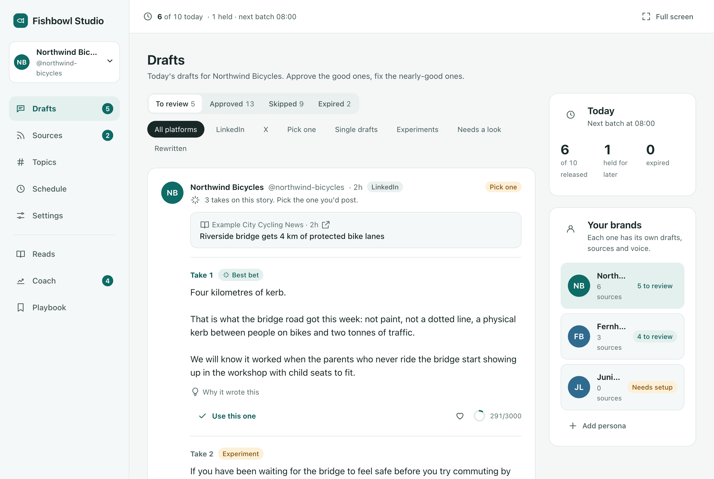
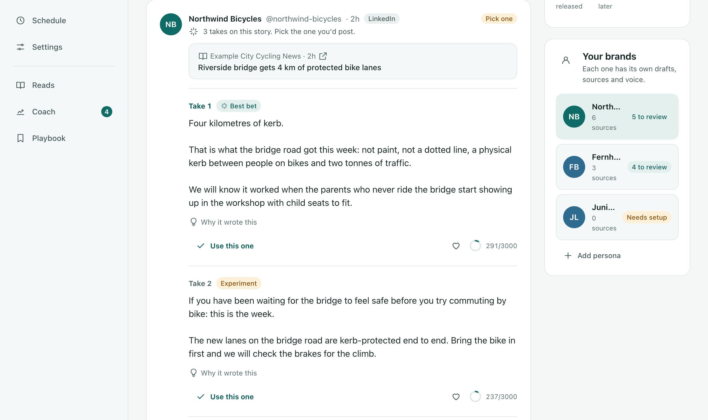
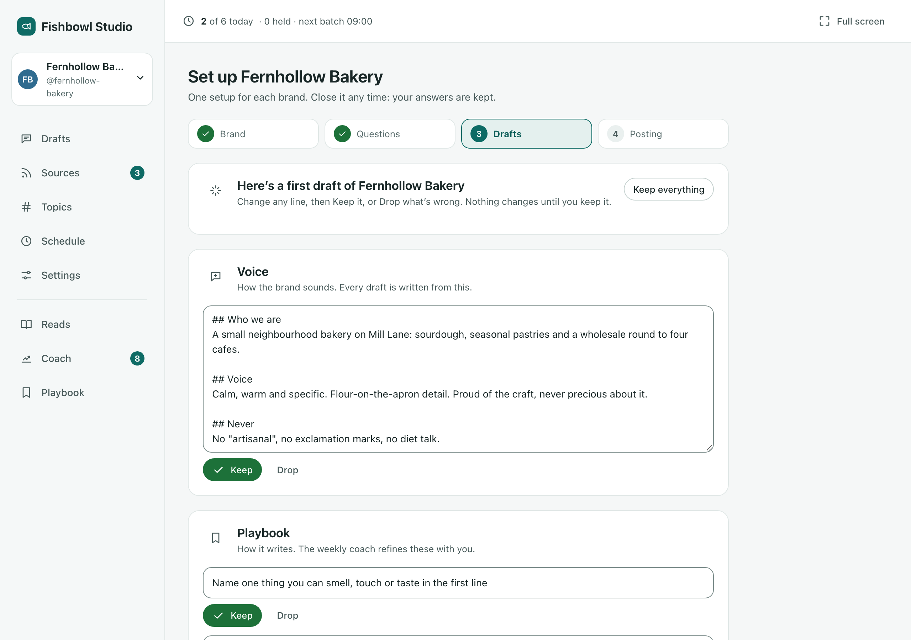
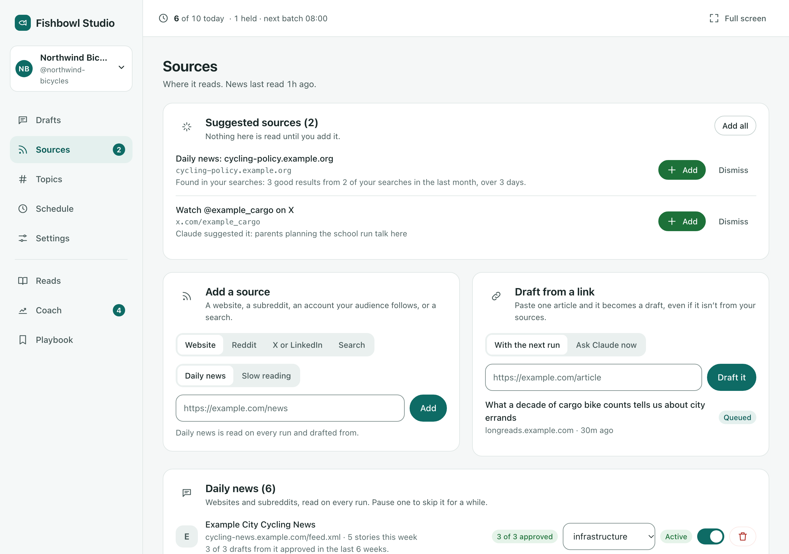
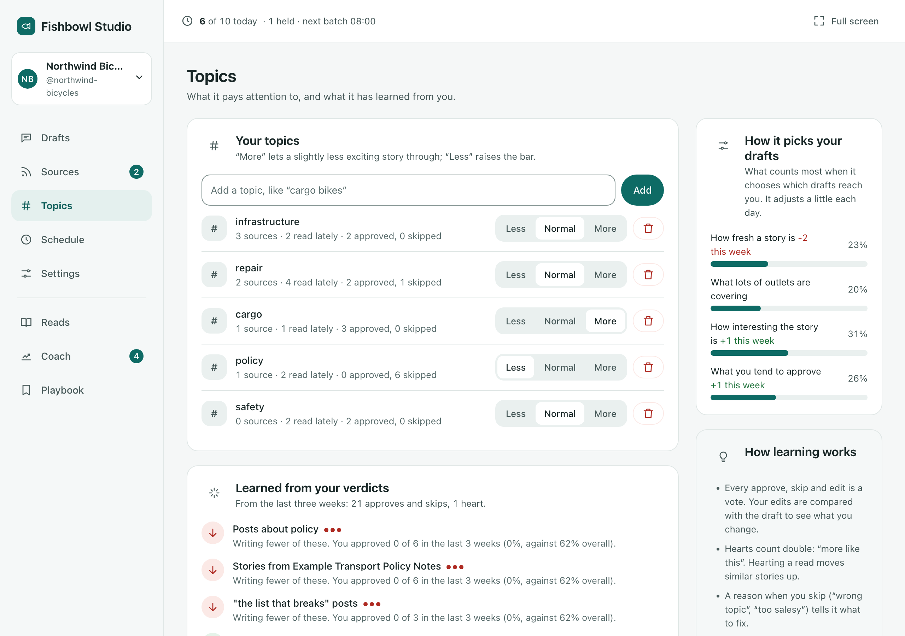
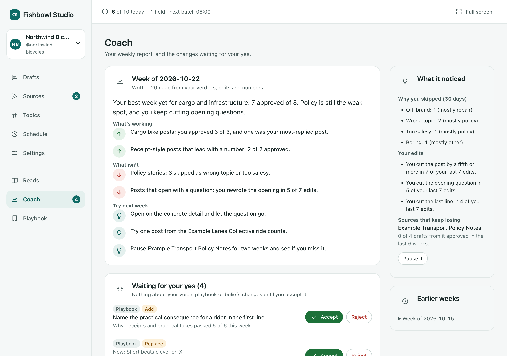
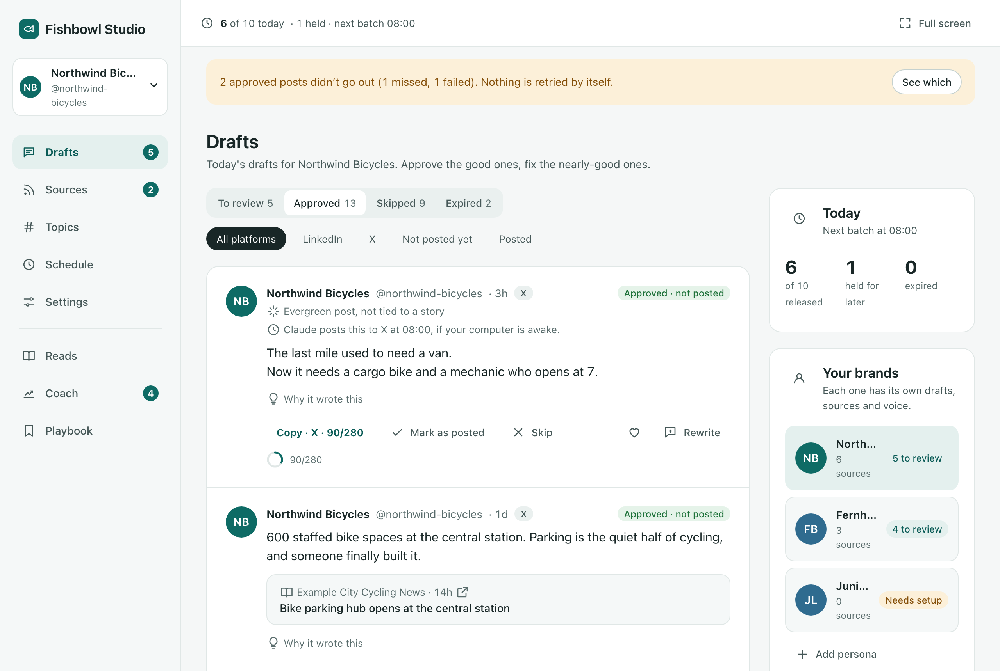
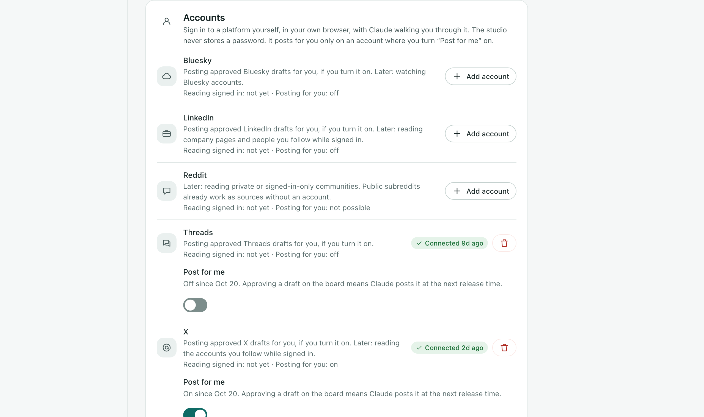
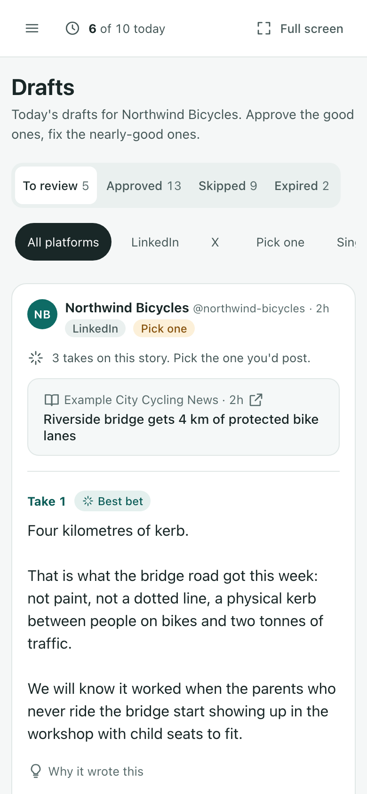
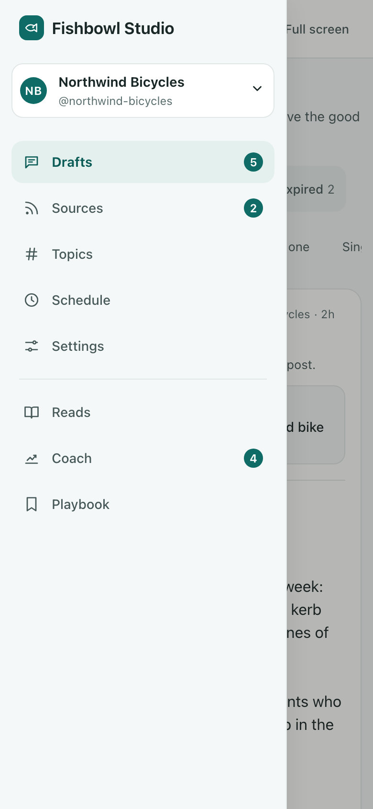

# Fishbowl Studio

**Your brand's posts, drafted every morning in your brand's voice. You just pick the good ones.**

Fishbowl Studio is for the person who writes a brand's LinkedIn, X, Threads and Bluesky posts. Every weekday it reads the news on your beat and the places your audience actually talks, drafts a few takes on each story worth talking about, and lays them out on a review board inside Claude. You approve the good ones, fix the nearly-good ones and skip the rest. It learns from every one of those, so it writes more like you the longer you use it.

It runs inside the Claude desktop app as a plugin. Nothing to host, no account to create.

  

> **You need** the Claude desktop app, a paid Claude plan that includes **Cowork**, and Node.js. It doesn't work on the free plan or in the browser. [Install it](#install-it) takes four steps.

## Your drafts, like a feed

Each draft looks like the post it'll become: your brand's name, the text, a character count, and **Approve**, **Edit**, **Skip** or **Rewrite** (leave a note like "too preachy" and Claude has another go). The story it's about sits underneath, and **Why it wrote this** shows the reasoning.

## Three takes, pick one

  

For a story worth it, Claude writes a few takes built different ways: one leads with the concrete detail, one asks the question the story raises, one says plainly what the brand thinks. **Best bet** marks its favourite. Not feeling any of them? **None of these** and it tries again.

## Set up a brand in five minutes

  

Give it the brand's name and answer four short questions (who it's for, how it should sound, what it talks about, what's off limits). Claude drafts a voice, topics and starter sources, and you keep or drop each line. Write for more than one brand? Each gets its own studio, and the switcher at the top of the sidebar moves between them.

## You choose what it reads

  

News sites, subreddits, X and LinkedIn accounts to watch, X trends and saved searches like "bike commuting". Each source keeps a record ("4 of 5 approved"), so you can see which ones earn their place. Claude can suggest new ones, but nothing gets read until you tap **Add**. Got one article you love? **Draft from a link**.

## It learns what you like

  

Turn topics up or down. Underneath, it shows what it has picked up from your approvals, skips and edits, and always says why ("you approved 0 of 6 posts about policy in the last 3 weeks").

## A coach every Friday

  

A short weekly report per brand: what's working, what isn't, two or three things to try. It also suggests changes to your voice, each with its reason ("you cut the opening question 7 of 9 times"). Nothing about your voice changes until you tap **Accept**.

## Approved, then posted

  

Copy an approved post and post it yourself. Or turn on **Post for me** for an account, and Claude posts what you approved at the next release time, in your own signed-in browser. If your laptop was asleep, the board tells you the slot was missed. It never posts late or retries on its own.

  

**Post for me** is off for every account until you switch it on, and switching it on shows a plain warning first: automated posting breaks LinkedIn's and X's rules and can get an account restricted. Your call, and you can turn it off any time.

## On your phone too

  
  &nbsp;&nbsp;
  

In a narrow Claude window the sidebar shrinks to icons, and on a phone it becomes a menu. If the board can't show at all, say "review my drafts" and do it in chat: *"pass 1a, kill 2, edit 3: …"*.

## Your day with it

- **7:00.** It reads your sources, drops duplicates (the same story from five outlets counts once) and drafts takes on the stories worth it.
- **8:00, 12:00, 16:00, 20:00.** A few drafts land on your board, up to ten a day, best first. Yesterday's news is cleared away.
- **Whenever.** Open the board, pick, tweak, approve.
- **Fridays.** Your coach report.

You can change all of those times on the **Schedule** page, down to reading the news every hour.

## Install it

1. In the Claude desktop app, open **Customize → Plugins**.
2. Click **Add marketplace** and enter `OWNER/fishbowl-studio`.
3. Install **Fishbowl Studio**.
4. Start a Cowork session and type **/studio:setup**. The setup wizard opens, and at the end one click asks Claude to run it every weekday.

You'll also need **Node.js**, the free LTS installer from [nodejs.org](https://nodejs.org). If it's missing, Claude tells you that one fix instead of showing an error.

Everything it keeps lives in one folder you can open: **Documents → Fishbowl Studio**.

## What it will never do

- **Post without your OK.** Only drafts you approved on the board, exactly as approved, and only on accounts where you turned **Post for me** on. Approving in chat never posts.
- **Read your messages, DMs or inbox.** It reads only the sources you added, and it looks at X and LinkedIn pages logged out. What it reads is treated as text to react to, never as instructions, and it never adds a source by itself.
- **Log in anywhere or keep passwords.** Connecting an account means Claude walks you through signing in yourself. The studio stores no password, token or cookie.
- **Send your stuff anywhere.** No analytics, no tracking, no servers of ours. Your drafts, notes and numbers stay in your Documents folder.
- **Change your voice behind your back.** It suggests; you accept.
- **Name private people.** A draft that names someone who isn't in the story goes back for a rewrite.
- **Make memes or images.** Words only.

<b>Handy things to say</b>

- "Show my studio board" · "Review my drafts" · "Do my rewrites"
- "Run the studio now" (`/studio:run`)
- "Add this feed: …", "Watch @… on X", "Save a search for …" (`/studio:add-source`; Claude suggests it, you tap Add)
- "Draft a post from this link: …"
- "Set up another brand" (`/studio:setup`) · "Switch to my other brand"
- "Learn my voice from these posts" (`/studio:voice`)
- "Write three evergreen posts" · "Weekly report"
- "Import these numbers" (attach the CSV export from LinkedIn or X analytics)
- "Post my approved posts now" (only what's due, on accounts where Post for me is on)

<b>How it runs on its own</b>

A plugin can't start itself: Claude runs it from a scheduled task in Cowork. **Set it up for me** (at the end of setup, or on the Schedule page) asks Claude to create it, and you approve it once. The Schedule page also shows exactly what to type if you'd rather do it by hand. If Post for me is on anywhere, a second task posts a few minutes after each release time.

Your computer has to be awake with Claude open for either to run. If Claude runs more often than your setting (say the task runs hourly and you chose "every 3 hours"), the studio skips reading the news that time and just releases what's due. One task runs all your brands.

Each brand has its own folder inside **Documents → Fishbowl Studio → personas**. If you used an earlier version, your studio moves in there by itself the first time this one starts.

<b>For developers</b>

- [How it works](docs/HOW-IT-WORKS.md): the pipeline, the ranking formula, how it learns.
- [Assumptions](docs/ASSUMPTIONS.md): platform behaviour we couldn't verify yet.
- `npm test` runs the tests. There are no runtime dependencies.
- `npm run dev` serves the board at http://localhost:7611 with two fictional demo brands. Add `?view=sources&width=390` to open a section at phone width.
- `npm run shots` screenshots every section at desktop and phone width into `dev/shots/` (needs Chrome). `npm run shots -- --readme` regenerates the images in this README.
- `npm run pack` builds a zip for **Upload plugin**.
- The board's look is one tokens file, `server/ui/skins/light.css`. A new skin is one more file beside it.

MIT licence · © Fishbowl Studio contributors
