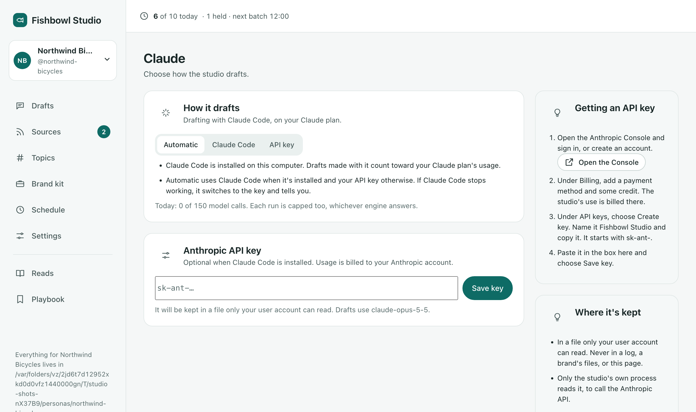
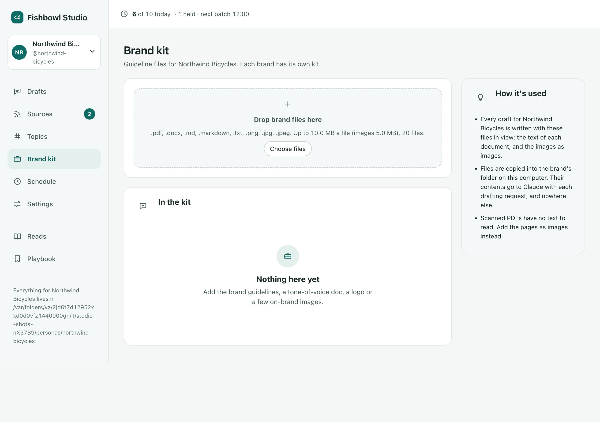

# Fishbowl Studio

```sh
npx github:MockSea/fishbowl-studio#v0.1.0
```

That starts the studio and opens it in your browser. It needs [Node.js](https://nodejs.org) 20 or later, on macOS, Windows or Linux. No Node? Use a [standalone build](#standalone-builds).

**Your brand's posts, drafted in your brand's voice. You pick the good ones.**

Fishbowl Studio is for the person who writes a brand's LinkedIn, X, Threads and Bluesky posts. It reads the news sites and subreddits you choose, drafts a few takes on each story worth talking about, and lays them out on a review board. You approve the good ones, fix the nearly-good ones and skip the rest. It learns from every one of those, so it writes more like you the longer you use it.

> [!WARNING]
> **Early alpha.** Expect rough edges, and please [open an issue](https://github.com/MockSea/fishbowl-studio/issues) when something breaks.

<p align="center">
  
</p>

## Starting it

The command prints a link and opens it in your default browser. The link works once; after that the browser keeps a cookie for this session. It runs while the terminal window is open. **Ctrl+C** stops it. Running the command again while it's already running opens a fresh link to the same studio instead of starting a second.

| Option | What it does |
| --- | --- |
| `--no-open` | Only print the link. |
| `--port 4100` | Use this port instead of a free one. |
| `--home <folder>` | Keep the studio's files in this folder. |

Its brand files and its own settings live in **Documents → Fishbowl Studio** in your home folder. Two things can sit elsewhere: your API key, in the system's secret store (below), and files it is working on for a moment (an upload being checked, a document being read), in the system's temporary folder. On a Mac, the first start may ask whether your terminal can use the Documents folder; allow it, or start with `--home` and another folder.

**From Claude Code.** Add the marketplace and install the plugin, then type `/fishbowl`. It runs the same `npx` command for you.

```
/plugin marketplace add MockSea/fishbowl-studio
/plugin install studio@fishbowl-studio
```

## Connecting Claude

The studio drafts with Claude in one of two ways. Its **Claude** page (it opens on that page until a key is saved or Claude Code is found on this computer, and later it's under **Settings → Engine and API key**) lets you choose; **Automatic** picks for you.

- **Claude Code.** If the `claude` command is installed and signed in, the studio uses it, on your Claude plan. Nothing else to set up.
- **An Anthropic API key.** Otherwise, paste a key on the Claude page. API use is billed to your [Anthropic Console](https://console.anthropic.com) account, separately from any Claude plan ([why](https://support.claude.com/en/articles/9876003-why-is-claude-api-usage-billed-separately-from-my-paid-claude-plan)).

In Automatic, if Claude Code can't start or can't finish a call (signed out, say) and a key is saved, the studio switches to the key and tells you. It stays on the key until you restart the studio or change the engine or the key. An answer that comes back but isn't usable is not a reason to switch: that call just fails.

To get a key: sign in at the Console, add credit under **Billing** (you can set a monthly spend limit there too), then create a key under **API keys**. The Claude page walks through the same steps.

<p align="center">
  
</p>

**Where the key is kept.** Never in a brand's files, a log, or the page. The studio uses the system's own secret store when there is one:

| System | Store |
| --- | --- |
| macOS | The login Keychain. |
| Windows | Encrypted for your Windows user with DPAPI. The encrypted copy is kept in the studio folder's `app/` folder. |
| Linux | Your desktop keyring (GNOME Keyring, KWallet) through `secret-tool`, when it's installed. |
| Anything else, Linux without `secret-tool`, or any system where saving to its store fails | A file only your user account can read, in the studio folder's `app/` folder. |

If `ANTHROPIC_API_KEY` is set and no key is saved, the studio uses that one.

## What it costs

The studio counts its work in **drafting steps**: one step is one request it hands to Claude, whichever way Claude is connected. With Claude Code it uses your plan's allowance; with a key it's billed per request. With a key it drafts with `claude-opus-5-5`; through Claude Code it uses the model Claude Code is set to. Setting `STUDIO_MODEL` overrides either.

| What you do | Drafting steps |
| --- | --- |
| Setup drafts (**Draft it for me**) | 1 |
| **Run it now** | Up to 40: reading the stories, then one to three for each story it drafts |
| A rewrite, a redo, or a link to draft | Up to 3 each, and up to 40 for the whole queue |
| **Run on its own**, each check | Up to 40, and none when nothing is due |
| The weekly report on **Coach** (by hand, or on Fridays when it runs on its own) | 2 |

It takes at most 150 steps a day in all. These limits count steps, not what each step costs: one step can turn into more than one request underneath (the API client retries a failed request, Claude Code can take a few turns, and a step that Claude Code couldn't run is sent again with your key), so they aren't a hard cap on requests or charges. Your brand kit goes with every step, so a big kit makes each one cost more. A story the model can't write well (it refuses, or every take is too long even after one redraft) is closed after those steps and never asked for again.

## From setup to your first drafts

1. **Set up a brand.** Give it the brand's name and, if you like, its website. Answer four short questions: who it's for, how it should sound, what it talks about, what's off limits. Then **Draft it for me** (one step).
2. **Keep what's right.** Claude drafts a voice, playbook, topics and starter sources. **Keep**, edit or **Drop** each line, and **Add** the suggested sources you want. **Finish setup**.
3. **Check your sources.** On **Sources**, make sure at least one site or subreddit is under **Daily news** and doesn't say **Not responding**. Add your own with **Add a source**: a news site's address or its RSS feed, or a subreddit like `r/bikecommuting`.
4. **Run it.** On **Schedule**, click **Run it now**. It reads your sources and drafts the stories worth it.
5. **Wait for the release time.** New drafts are held and come out at the next release time (8:00, 12:00, 16:00 and 20:00 unless you change them), best first. They then appear on **Drafts**.

<p align="center">
  
</p>

## Your drafts, like a feed

Each draft looks like the post it'll become: your brand's name, the text, a character count, and **Approve**, **Edit**, **Skip** or **Rewrite** (leave a note like "too preachy" and Claude has another go). The story it's about sits underneath, and **Why it wrote this** shows the reasoning.

By default, each story gets three takes with different structures (Settings can make it one or two). **Best bet** marks its favourite. Not feeling any of them? **None of these** and it tries again.

<p align="center">
  
</p>

Each source keeps a record ("4 of 5 approved"), so you can see which ones earn their place. Got one article you love? **Draft from a link** on the Sources page.

On **Topics**, turn topics up or down. Underneath, it shows what it has picked up from your approvals, skips and edits, and always says why ("you approved 0 of 6 posts about policy in the last 3 weeks"). Patterns in your edits (say you keep cutting the opening question) become suggested playbook changes on the **Playbook** page. Nothing changes until you accept one.

<p align="center">
  
</p>

Copy an approved post and post it yourself. The studio never posts.

Write for more than one brand? Each gets its own studio, and the switcher at the top of the sidebar moves between them.

<p align="center">
  
  &nbsp;&nbsp;
  
</p>

## Brand kit

Each brand has a **Brand kit** page. Drag in brand guidelines, a tone-of-voice doc, a logo or on-brand images, or choose them with **Choose files**.

- PDF, Word (.docx), Markdown and plain text are read as text. Scanned PDFs have no text; add those pages as images.
- PNG and JPG are sent as images.
- Up to 20 files a brand, 10 MB a file, 5 MB an image, and 60 MB in all.
- Each step carries up to 60,000 characters of kit text and up to 6 images, taken in the order the files are listed. Files further down can be left out of a step even when none of them was cut short.

Files are copied into the brand's `brand-kit/` folder. The page shows what was read from each one, and **Remove** deletes the copy. The kit is sent as reference material, never as instructions. PDF and Word extraction runs in a child process with memory and time limits.

<p align="center">
  
</p>

## Running on its own

The studio only works while it's running. **Run on its own** is off until you turn it on (on the Schedule page, or at the end of setup). Release times work either way. Batches whose release time passed while the studio was closed come out when you next start it, and it says how many.

With it on, the studio checks every five minutes. Each check reads the news only when your Schedule setting says it's due (by default once a day on weekdays) and drafts only what's new. A check with nothing due sends nothing to Claude. After a run that fails, that brand waits an hour before trying again.

**How many drafts a day.** It releases up to ten sets a day, where a set is the takes on one story, so ten sets can be more than ten drafts. A run can write more than that (by default up to 12 stories and 2 evergreen sets); the best are released first. A held draft older than 16 hours is cleared at the next release time instead of released, and sets left over at the day's last release time are cleared too.

## Standalone builds

Each [release](https://github.com/MockSea/fishbowl-studio/releases) has one-file builds with Node inside, for macOS (Apple silicon and Intel), Windows (x64) and Linux (x64), and a `SHA256SUMS` file. The install scripts download the build for your computer, check it against `SHA256SUMS`, install it and start it:

```sh
# macOS and Linux: installs to ~/.local/bin/fishbowl-studio
curl -fsSL https://raw.githubusercontent.com/MockSea/fishbowl-studio/main/scripts/install.sh | sh
```

```powershell
# Windows: installs to %LOCALAPPDATA%\Programs\Fishbowl Studio
irm https://raw.githubusercontent.com/MockSea/fishbowl-studio/main/scripts/install.ps1 | iex
```

After that, start it with `fishbowl-studio`. It takes the same options as the `npx` command.

The builds aren't signed by Apple or Microsoft. The install scripts download with `curl` and PowerShell, which don't mark the file as downloaded from the internet, so the system doesn't stop it. If you download a build in your browser instead:

- **macOS** says it can't check the app for malicious software. Open **System Settings → Privacy & Security**, scroll to **Security**, click **Open Anyway** next to fishbowl-studio and confirm ([Apple's steps](https://support.apple.com/en-us/102445)). Or remove the download mark in Terminal: `xattr -d com.apple.quarantine fishbowl-studio-macos-arm64`. Then make it runnable with `chmod +x`.
- **Windows** SmartScreen says it protected your PC. Click **More info**, then **Run anyway**.
- **Linux** needs `chmod +x fishbowl-studio-linux-x64` before it runs.

Check a browser download against `SHA256SUMS` first: `shasum -a 256 <file>` on macOS, `sha256sum <file>` on Linux, `Get-FileHash <file>` in PowerShell.

## What it will never do

The studio listens only on 127.0.0.1, and a page has to come in through the one-time link to get the session cookie, so other computers can't reach it and other sites open in your browser can't read it or make it do anything.

- **Post without your OK.** It doesn't post at all.
- **Read your messages, DMs or inbox.** It reads only the sources you added. What it reads is treated as text to react to, never as instructions, and it never adds a source by itself.
- **Log in anywhere or keep passwords.** It stores no password, token or cookie for any site, only your API key if you give it one.
- **Send your stuff anywhere you didn't choose.** No analytics, no tracking, no servers of ours. It reads the sources you added and sends each drafting request to Claude (through Claude Code or the Anthropic API): the stories, your voice, playbook and settings, the draft being rewritten, and your brand kit. Nothing else leaves your computer.
- **Change your voice behind your back.** It suggests; you accept.
- **Name private people without telling you.** A draft that names someone who isn't in the story goes back for one rewrite, and if the name is still there the draft is flagged on the board.
- **Make memes or images.** Words only.

## For developers

[Developing](docs/DEVELOPING.md) has the commands, how the studio is put together, the settings for trying it, and how to run it against a local mock of the API. [How it works](docs/HOW-IT-WORKS.md) covers the pipeline, the ranking and how it learns.

MIT licence · © Fishbowl Studio contributors
